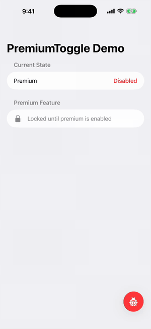

# PremiumToggle

[](https://github.com/tjb/PremiumToggle/actions/workflows/ci.yml)

A SwiftUI debug overlay for toggling premium state during iOS development, hidden in Release builds by default.

<p align="center"></p>

## Features

- Floating Liquid Glass ladybug button that opens a debug popover
- Force premium on or off, or go back to your real status
- Overrides persist across launches via `UserDefaults`
- Hidden in Release builds by default, with an explicit `isEnabled` switch for QA or TestFlight builds
- Protocol-based and built on Observation, so it works with your existing premium manager

## Requirements

- iOS 26+ / macOS 26+
- Swift 6.2+ (Xcode 26+)

## Installation

### Swift Package Manager

In Xcode: **File → Add Package Dependencies**, enter the repository URL.

Or add to your `Package.swift`:

```swift
dependencies: [
    .package(url: "https://github.com/tjb/PremiumToggle", from: "1.0.0")
]
```

## Usage

Conform your `@Observable` premium manager to `PremiumStatusProvider`. Keep your real status separate from the override so clearing it restores the real value immediately. `PremiumDebugOverride` stores the override for you:

```swift
import Observation
import PremiumToggle

@MainActor
@Observable
final class MyPremiumManager: PremiumStatusProvider {
    var isPremium: Bool { debugOverride ?? isEntitled }
    private(set) var debugOverride: Bool?
    private(set) var isEntitled = false // your real StoreKit status

    let allowsDebugOverride: Bool
    private let overrideStorage = PremiumDebugOverride()

    init(allowsDebugOverride: Bool = PremiumToggleBuild.isDebug) {
        self.allowsDebugOverride = allowsDebugOverride
        if allowsDebugOverride {
            debugOverride = overrideStorage.value
        }
    }

    func setDebugOverride(_ value: Bool?) {
        guard allowsDebugOverride else { return }
        overrideStorage.value = value
        debugOverride = value
    }
}
```

Create the manager once at the app root and attach the toggle there:

```swift
@main
struct MyApp: App {
    @State private var premiumManager = MyPremiumManager()

    var body: some Scene {
        WindowGroup {
            ContentView()
                .environment(premiumManager)
                .premiumToggle(premiumManager)
        }
    }
}
```

Child views read it with `@Environment(MyPremiumManager.self) private var premiumManager`.

> If your app already has a `MyPremiumManager.shared` singleton, pass that instead: `.premiumToggle(MyPremiumManager.shared)`. Don't wrap a singleton in `@State` or `@StateObject`; those mean "this view owns the object."

### Showing the toggle outside Debug builds

`.premiumToggle` only appears in Debug builds by default. A provider that follows the pattern above also ignores overrides in Release, so a leftover override can never unlock premium in production. The protocol's `allowsDebugOverride` defaults to `true`, so gate it yourself as the sample does. Custom configurations such as Staging or QA build Swift packages as Release, so turn on both explicitly:

```swift
@State private var premiumManager = MyPremiumManager(
    allowsDebugOverride: AppConfig.showsDebugTools
)

// ...
.premiumToggle(premiumManager, isEnabled: AppConfig.showsDebugTools)
```

If the panel is shown but the provider doesn't allow overrides, its controls are disabled with a note saying so.

In a `TabView` app, attach `.premiumToggle` inside a tab or pass `alignment:` so the button doesn't cover the tab bar.

## How it works

The panel calls `setDebugOverride(_:)` on your provider. `true` or `false` forces premium on or off; `nil` ("Use Real Status") clears the override so the provider falls back to its real state. `PremiumDebugOverride` persists the value in `UserDefaults` under `debug_premium_override` (configurable).

## Example app

`Example/PremiumToggleDemo.xcodeproj` is a small app that uses the package through a local reference.

1. Open `Example/PremiumToggleDemo.xcodeproj`.
2. Select the `PremiumToggleDemo` scheme and an iOS simulator.
3. Run.

Tap the ladybug button in the bottom-right corner to open the panel, then switch premium on and off. The list updates immediately.

## Development

```sh
# Package tests (macOS)
swift test

# Demo app (iOS Simulator)
cd Example
xcodebuild build \
  -project PremiumToggleDemo.xcodeproj \
  -scheme PremiumToggleDemo \
  -destination 'generic/platform=iOS Simulator'
```

Issues and pull requests are welcome. Please run the tests and build the demo before opening a PR.

## License

PremiumToggle is available under the MIT license. See [LICENSE](LICENSE).
